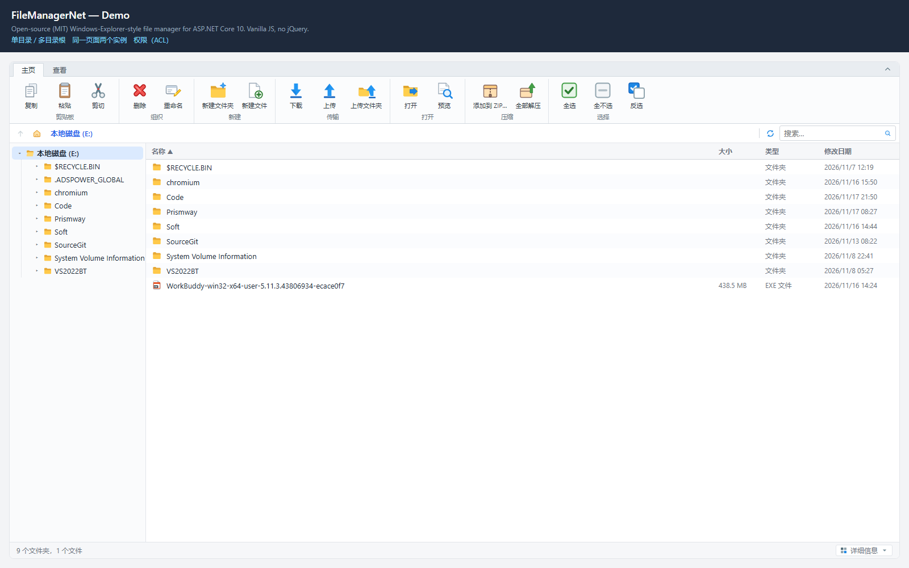
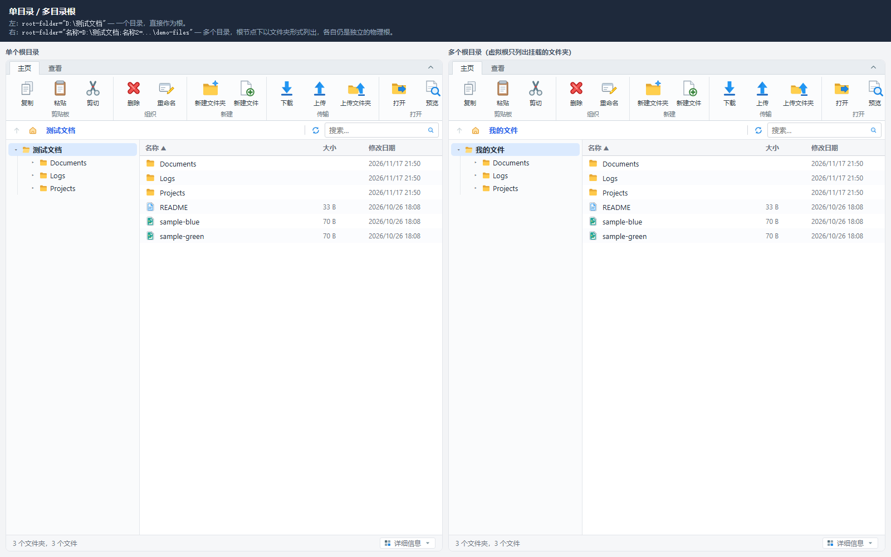
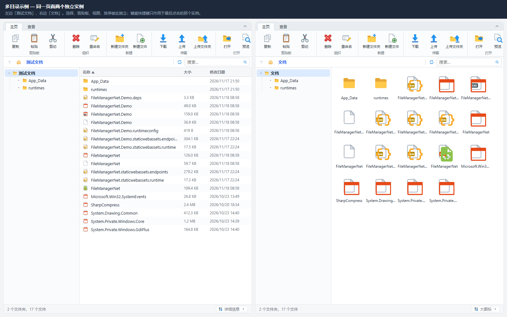

# FileManagerNet

**Free & open-source (MIT) Windows-Explorer-style file manager control for ASP.NET Core 10.**

A Razor Class Library that mounts as a tag helper and ships its own HTTP API, with a
desktop-explorer-style UI (ribbon toolbar, folder tree, breadcrumb, multi-view layouts).
Built from scratch with **vanilla JS — no jQuery, no third-party npm packages**.

Official website: <https://www.virtuamesh.com/>

 

> 📘 **完整配置手册（中文）**：[`docs/configuration.zh-CN.md`](docs/configuration.zh-CN.md) —
> 每个配置项的确切含义与默认值、权限（ACL）规则、HTTP API、常见场景配方、故障排查。

## Screenshots

**Main window — ribbon, folder tree, breadcrumb and Details view**



**Single root folder and virtual multi-root in one page**



**Two independent instances on the same page — Details and Large icons**



## Features

- **Windows Explorer-like UI** — ribbon with **Home / View tabs** (grouped buttons with captions,
  desktop-explorer-style context menus with View & Sort-by submenus), navigation (folder tree) pane,
  breadcrumb bar with up/home/refresh/search, and a status bar with the item counts and the
  view switcher.
- **Multiple instances per page** — drop as many `<file-manager>` tags as you like, each bound
  to its own root folder. Selection, clipboard, view layout, sorting and search are all per
  instance; the stylesheet and scripts are emitted **once per request**, and keyboard shortcuts
  only act on the pane you clicked last. See `demo/FileManagerNet.Demo/Pages/Multi.cshtml`.
- **One or several root folders per instance** — `root-folder` takes a single folder or a
  `;`-separated list, optionally named (`root-folder="数据=D:\Data;备份=E:\Backup"`). With several
  folders the root node lists them as folders; each keeps its own physical root server-side, and
  copy/move works across them (even across volumes). See `Pages/Roots.cshtml`.
- **Folder-level permissions (ACL)** — mount read-only folders next to writable ones in the same
  instance, restrict a folder to image uploads, cap it with a quota, or deny it entirely. Rules are
  matched by path with nearest-ancestor inheritance and deny-wins semantics; every operation is
  checked **on the server**, and the ribbon and context menus hide what the current folder forbids.
  See `Pages/Acl.cshtml`.
- **Mouse selection & drag-to-move** — drag across empty space to rubber-band select (Ctrl/⌘ adds to
  the current selection, a plain click clears it); drag one or many items onto a folder row, a tree
  node or a breadcrumb to move them, with a live drop-target highlight. Dropping a folder onto
  itself or into its own subtree is rejected, and OS file drops still fall through to upload.
- **Collapsible ribbon** — the chevron at the right of the tab strip collapses the ribbon to the
  tabs only (∧ collapse / ∨ expand); while collapsed, clicking a tab pops the group bar out over
  the content, and the **pin** button there keeps it expanded. State is persisted.
- **Windows-ribbon look** — 32 px colourful action icons in the Explorer/ribbon idiom (copy,
  paste, scissors, red **X**, folder + sparkle, blue upload/download arrows…), a white active tab
  merging into the ribbon body, group captions at the bottom and hairline group separators. The
  artwork is drawn for this project (SVG), so it scales and ships without third-party assets.
- **Desktop-explorer-style menus** — context menus and dropdowns use a classic gray look:
  `#f2f2f2` background, square 1px border, 22 px rows with 16 px icons, blue
  `rgba(0,140,255,.4)` hover, indented separators and a check mark on the current
  view/sort item.
- **Home tab**: Clipboard (Copy/Paste/Cut), Organize (Delete/Rename), New (folder/file),
  Transfer (Download / Upload / Upload folder), Open (Open/Preview), Compression (Add to zip / Extract all),
  Select (All / None / Invert).
- **View tab**: Panes (navigation / preview / details pane), Layout (7 layouts), Sort by,
  Show-hide (file name extensions, hidden items).
- **7 view layouts**: Extra large icons, Large icons, Medium icons,
  Small icons, List, Details (sortable columns), Tiles. Layout, panes and toggles are
  persisted per instance.
- **Stays smooth with tens of thousands of entries** — above 300 items the list renders only the
  rows around the viewport (**virtual scrolling**): Details uses spacer rows, the icon/list/tile
  views a translated window, so a 12 000-file folder keeps ~30 DOM nodes, shows the correct
  scrollbar height and scrolls normally. The scroll position survives selection changes, and the
  grid column count is recomputed on resize.
- **Compact path bar**: on one line — **up one level**, **home**, breadcrumb,
  a thin divider, **refresh**, then the search box with its magnifier on the right. Long paths
  collapse their middle segments into a "…" menu, the *up* button greys out at the root, and
  the **view switcher sits at the right end of the status bar**.
- **Responsive**: below 940 px the ribbon buttons collapse to icons with tooltips; below 700 px a
  navigation toggle appears at the left of the path bar, the folder tree becomes a slide-in drawer
  (instead of disappearing), and the details/preview pane narrows.
- **Image thumbnails** and inline **preview** for images / video / audio / PDF / text & code files.
  Images open in a real viewer: **wheel / pinch / button zoom (5 %–1600 %), drag to pan,
  rotate in 90° steps, flip horizontally or vertically**, fit / 1:1 / reset, arrows and
  `+ - 0 1 r f` shortcuts, natural pixel size in the toolbar, and a transparent check pattern
  behind the image.
  **Markdown files render as a formatted document** (headings, lists, tables, task lists, code
  fences, quotes, relative images and links) with a **Preview / Source** switch in the dialog
  header; raw HTML inside a `.md` file is shown as text, never executed.
  Media is streamed through `GET {api}/download?inline=1` with **HTTP range support** (206),
  so the `<video>` / `<audio>` seek bar can be dragged instead of only playing from the start.
  When the browser cannot play a container/codec (mkv/avi on Chrome, …) the dialog says so and
  offers the file for download instead of showing a dead player; PDFs are preflighted (a 2-byte
  range request) so a missing/broken file produces a message rather than an empty frame. Text
  previews above **4 MB** fetch only the first 4 MB and mark the truncation.
  Text previews **auto-detect the encoding** (BOM for UTF-8 / UTF-16 LE/BE, BOM-less UTF-16 via
  NUL parity, strict UTF-8, then script-likelihood scoring across GB18030, Big5, Shift-JIS,
  EUC-KR, Windows-1251 and Windows-1252) and offer **31 encodings** in a header dropdown
  (Unicode, CJK, Japanese, Korean, Western/Central-European, Cyrillic, Greek, Turkish,
  Hebrew, Arabic, Baltic, Vietnamese, Thai, Mac); the manual choice is remembered per extension.
- **Office online preview** (optional) — Word / Excel / PowerPoint / OpenDocument files are
  converted to PDF by **LibreOffice headless** on the server and shown inline in the preview
  dialog. The converted PDF is cached by path + size + mtime, conversions are queued and can be
  time-limited, and the whole feature is switched on per instance. When the switch is on but
  LibreOffice cannot be found, the server reports `officePreviewAvailable: false` and the client
  **disables preview for Office files** (context-menu item greyed out, double-click explains why).
- **Vector file-type icons** — 58 crisp SVGs from
  [Material Icon Theme](https://github.com/PKief/vscode-material-icon-theme) (MIT) cover ~250
  extensions: Word blue **W**, Excel green **X**, PowerPoint orange **P**, PDF, images, video,
  audio, archives and 40+ programming languages. Being vector they stay sharp from the 14 px
  Details row up to the 56 px Extra-large grid. Unknown extensions — and any failed request —
  fall back to the built-in SVG set, so nothing ever renders as a broken image.
- **Optional system icons** — `UseSystemIcons = true` switches to the icon Windows registers for
  each extension instead (`GET {api}/icon?ext=docx`, cached PNG). Off by default because those
  are only 32 px and soften when scaled up.
- **Full CRUD**: new folder / new file, rename, delete (multi-select), copy & cut & paste
  (client-side clipboard).
- **Name-conflict prompt**: when pasting, dropping or moving onto a folder that already contains
  the same name, nothing is written until you choose **Cancel / Keep both / Replace**. "Keep both"
  generates `name (1).ext`, `name (2).ext`… on the server; the whole batch is pre-checked, so a
  conflict never leaves a half-applied copy behind.
- **Upload** — chunked, resumable, folder-aware:
  - files are sent as **8 MB chunks** (`upload/init` → `upload/chunk` → `upload/complete`), so a
    **10 GB+ file** works: the request is a plain body, not multipart, and never hits the
    request-size limit; `MaxUploadBytes = 0` means unlimited;
  - **resume**: the session id is derived from file identity, so after a network drop (or a browser
    restart) re-selecting the same file continues from the server's `received` offset instead of
    starting over; a chunk that arrives at the wrong offset is rejected with the real offset;
  - **folder upload**: drag a whole folder from the desktop (FileSystemEntry walk) or use
    *Upload folder* in the ribbon / context menu — the hierarchy is recreated on the server;
  - per-file progress dialog with cancel, and *Overwrite / Cancel* prompt when the name exists.
- **Download**: single file, multi-select or whole folders auto-zipped on the fly.
- **Compress / Extract** many archive formats via [SharpCompress](https://github.com/adamhathcock/sharpcompress) (MIT):
  - create **zip**, **tar**, **tar.gz / .tgz**, **tar.bz2 / .tbz2** (choose the format in the compress dialog);
  - extract **zip, 7z, rar (RAR4/RAR5), tar, tar.gz, tar.bz2, gz, bz2, xz, zst, lzip, arj, ace, arc, lzw**;
    select several archives and **Extract all** runs them one after another;
  - zip-slip protection on every entry; 7z/RAR creation is not possible (RAR is proprietary, 7z needs 7-Zip);
  - **live progress** — both operations run as a background job (`POST {api}` with `"async": true`
    returns a `jobId`, polled via `GET {api}/job?id=…`), so the dialog shows a real percentage,
    the current entry and elapsed time, and can be sent to the background while you keep browsing;
  - a **completion / failure notification** appears bottom-right and the list refreshes itself.
- **Search**: recursive, from any folder, results banner with one-click clear.
- **Folder tree** with lazy loading and expand/collapse.
- **Keyboard support**: `Delete`, `F2`, `Ctrl+A`, `Ctrl+C`, `Ctrl+X`, `Ctrl+V`.
- **Feature toggles**: disable upload/delete/rename/archive/search… — hidden from the UI *and*
  rejected server-side.
- **Localization**: 9 built-in languages — English, 简体中文, 繁體中文, 日本語, 한국어, Deutsch,
  Français, Español, Русский — one file per language, loaded on demand. Defaults to the
  browser language; can be forced per instance; custom languages/overrides can be
  registered client-side.
- **Path-safety**: all paths are virtual (root-relative); traversal (`..` segments), NUL and
  Windows drive/stream syntax are rejected; each control instance's root is registered
  server-side only. File names keep the characters the host OS allows — `:` and `..` inside a
  name work on Linux/macOS, and matching is case-sensitive there.
- Cross-platform (Windows / Linux / macOS), zero external JS dependencies.

## Access control

Permissions are enforced **on the server for every operation** — hiding a button in
the browser never grants anything, and a hand-written API call gets a **403**.

```csharp
var root = new FileManagerRoot(@"D://Shared", "Shared");

root
    // the whole tree is read-only …
    .Allow("/", FileManagerPermissions.ReadOnly)
    // … except this folder, which also takes uploads, deletes and renames
    .Allow("/public", FileManagerPermissions.ReadOnly
        | FileManagerPermissions.Create | FileManagerPermissions.Upload
        | FileManagerPermissions.Delete | FileManagerPermissions.Rename
        | FileManagerPermissions.Paste)
    // images only, at most 500 MB below this folder
    .Allow("/public/images",
        FileManagerPermissions.ReadOnly | FileManagerPermissions.Upload | FileManagerPermissions.Create,
        allowedFileTypes: "*.jpg|*.png|*.webp",
        quota: "500 MB")
    // no access at all — the folder cannot be opened
    .Allow("/secret", FileManagerPermissions.None);

FileManagerRegistry.Register("FM_DOCS", new[] { root }, "Shared", new FileManagerConfig());
```

The page then renders `<file-manager id="FM_DOCS" root-folder="D://Shared" ... />`: the tag
helper re-registers the instance (to pick up the rendered path) but **keeps the rules the
host attached**. A full example is `demo/FileManagerNet.Demo/Pages/Acl.cshtml`.

| Rule | Behaviour |
|---|---|
| Scope | An entry covers its own folder and everything below it. |
| Inheritance | The **deepest** matching entry wins; levels are not merged, so a subfolder can widen or narrow what it inherited. |
| Deny wins | `Denied` is removed from `Allowed`. |
| File types | `AllowedFileTypes` / `DeniedFileTypes` hide files from listings and reject download, preview and upload; folders stay visible. `DeniedFileTypes` wins. |
| Quota | `Quota` (`"500 MB"`, `"2 GB"`) limits the data below the entry's folder. Checked before a write; the size is measured once and then kept up to date incrementally, so a check is a dictionary lookup. |
| Host cap | The instance-level `FileManagerConfig` switches still apply — a rule can never grant what the host disabled globally. |
| UI | `list` returns the folder's effective flags; ribbon buttons and context-menu items follow automatically. |

Permission flags: `ListSubfolders`, `ListFiles`, `Create`, `Delete`, `Rename`,
`Edit` (replace an existing file), `Upload`, `Download`, `Compress`, `Extract`,
`Cut`, `Copy`, `Paste`, `Preview` — plus the `ReadOnly` and `Full` combinations.
Paths accept `*` (within a segment) and `**` (across segments), e.g. `/dept-*/docs`.

Cost: resolving a folder is a handful of segment comparisons plus a dictionary hit
(~17 µs cold in a Debug build, memoised per folder afterwards), which is why every
file operation can afford to check it. See *Concurrency and performance* below.

## Quick start

```bash
dotnet run --project demo/FileManagerNet.Demo
# open http://localhost:5099  (use Development env for static assets in dev)
```

The demo uses its own `App_Data/demo-files` folder, so it runs unchanged on Windows, Linux and
macOS. `root-folder` takes a native absolute path: `D:\Data` on Windows, `/srv/data` on Linux,
`/Users/you/Documents` on macOS.

### 1. Install the services

```csharp
using FileManagerNet;

var builder = WebApplication.CreateBuilder(args);
builder.Services.AddFileManagerNet();
builder.Services.AddRazorPages();
```

### 2. Map the API endpoint

```csharp
app.MapFileManagerNet("/filemanager-api", o =>
{
    o.RootFolder = Path.Combine(env.ContentRootPath, "App_Data", "demo-files");
    o.RootDisplayName = "Demo Files";
});
```

### 3. Drop the control into any Razor page / view

```html
@addTagHelper *, FileManagerNet

<file-manager id="FM1"
              root-folder="./App_Data/demo-files"
              root-name="Demo Files"
              api-endpoint="/filemanager-api" />
```

> The `id` must be application-wide unique. Each instance (root folder + config) is registered
> server-side by the tag helper; the browser only ever sends the instance id.

#### One or several root folders

`root-folder` accepts one folder or a `;`-separated list. Each entry may be prefixed with a display
name and `=` (`root-folders` is an alias for readability):

```html
<!-- a single folder: it is the root and its content is listed directly -->
<file-manager id="FM1" root-folder="D:\Data" root-name="Data" api-endpoint="/filemanager-api" />
<file-manager id="FM1" root-folder="/srv/data" root-name="Data" api-endpoint="/filemanager-api" />

<!-- several folders: the root node lists them as folders -->
<file-manager id="FM2"
              root-folder="数据=D:\Data;备份=E:\Backup;demos=C:\inetpub\demos"
              root-name="我的文件"
              api-endpoint="/filemanager-api" />
<file-manager id="FM2"
              root-folder="data=/srv/data;backup=/mnt/backup"
              root-name="Files"
              api-endpoint="/filemanager-api" />
```

How it behaves:

- Every folder is still an independent physical root on the server — nothing outside them is
  reachable, and each virtual path is `/<mount name>/...`.
- The virtual root (`/`) only lists the folders: new folder / new file / paste / upload / drop are
  refused there (the UI tells you to open a folder first), and the folder entries themselves
  cannot be renamed, deleted, moved or copied.
- Copy / cut / paste and drag & drop work **between** the folders; a move across volumes falls back
  to copy + delete.
- Tree pane, breadcrumb, search, archive, download and Office preview all treat the folders as
  ordinary folders.

The same thing from code:

```csharp
app.MapFileManagerNet("/filemanager-api", o =>
{
    o.RootFolders.Add(new FileManagerRoot(@"D:\Data", "数据"));
    o.AddRoot(@"E:\Backup", "备份");            // fluent alternative
    o.RootDisplayName = "我的文件";
});
```

### 4. Optional per-instance configuration

```html
@using FileManagerNet.Models
@{
    var cfg = new FileManagerConfig {
        AllowUpload = true,
        AllowArchive = false,          // hides Zip/Extract buttons, rejects zip/extract API calls
        MaxUploadBytes = 256 * 1024 * 1024,   // per file; 0 = unlimited (chunked upload)
        DefaultView = ViewLayout.Tiles,
        HiddenPatterns = "*.log;*.tmp",
        ShowFileExtensions = false,    // View tab → file name extensions (default off)
        ShowHiddenFiles = false,       // View tab → hidden items (dot-prefixed)
        ShowFoldersPane = true,        // View tab → navigation pane
        OfficePreviewEnabled = true    // Office → PDF preview (needs LibreOffice, see §6)
    };
}
<file-manager id="FM2" root-folder="D:\Data" api-endpoint="/filemanager-api" config="cfg" />
```

### 5. Office online preview (LibreOffice)

Office documents are converted to PDF with a headless LibreOffice process and served from
`GET {api}/office?instance=…&path=…`; the preview dialog embeds it. Nothing else is required on
the client — no plugin, no Office on the viewer's machine.

1. **Install LibreOffice** on the server (Windows / Linux / macOS, incl. Docker images).
   On Linux also install CJK fonts (`fonts-noto-cjk`), otherwise Chinese/Japanese text turns
   into boxes.
2. **Enable it** per instance:

```csharp
var cfg = new FileManagerConfig {
    OfficePreviewEnabled = true,
    // Optional — empty means auto-detect (Program Files, /usr/bin, /Applications, PATH):
    LibreOfficePath = @"C:\Program Files\LibreOffice\program\soffice.exe",
    OfficeConvertTimeoutSeconds = 60,   // a hung conversion is killed
    OfficeCacheMinutes = 1440,          // converted PDFs are reused for a day
    OfficePreviewMaxBytes = 100L * 1024 * 1024,
    OfficeCacheFolder = ""              // default: %TEMP%/fmnet-office-cache
};
```

Notes:

- Conversions run at most 2 at a time per process and each uses a throw-away LibreOffice
  profile directory, so multiple requests cannot lock each other.
- The cache key is `path + size + last-modified`; editing a file invalidates its PDF.
  Put `OfficeCacheFolder` outside the served root so cached PDFs are not browsable.
- `7z`/`rar` are unrelated here — archives use SharpCompress (§ features).
- If LibreOffice cannot be found the endpoint answers `500` with
  `LibreOffice was not found. Set FileManagerConfig.LibreOfficePath.` and the dialog shows
  the message — the rest of the control keeps working.

Excel sheets are rendered as PDF pages, so very wide sheets are paginated; use the browser's
zoom or download the original file when you need the grid.

### 6. Language / localization

The UI picks its language automatically from the browser settings
(`navigator.languages`, with base-language fallback, English as final fallback).
To force a language, either set the attribute:

```html
<file-manager id="FM1" root-folder="D:\Data" locale="zh-CN" />
```

or set it in the config (applies to every instance created that way):

```csharp
var cfg = new FileManagerConfig { Locale = "zh-CN" };
```

Built-in languages: `en`, `zh-CN`, `zh-TW`, `ja`, `ko`, `de`, `fr`, `es`, `ru`.
Each language ships as its own file under `js/locales/fmnet.locale.<id>.js`
and is **loaded on demand** — only the resolved language plus the `en`
fallback are fetched at runtime, so pages pay for exactly one dictionary.

Additional languages can be added client-side without touching the library:
register the dictionary on `window.FMNetLocales` from any script that runs
before initialization, then reference the id via `locale="…"` (or let the
browser language matching pick it up):

```html
<script>
  window.FMNetLocales = window.FMNetLocales || {};
  window.FMNetLocales["pt"] = { newFolder: "Nova pasta", /* … */ };
</script>
<file-manager id="FM1" root-folder="D:\Data" locale="pt" />
```

A custom dictionary may also **override** built-in keys of a bundled language
by assigning to the same id (e.g. `window.FMNetLocales["zh-CN"] = { … }`).

Dates and sizes already follow the browser locale (`toLocaleDateString`).
Note: server-side error messages (e.g. "Item already exists") are currently English only.

## Solution layout

```
FileManagerNet/
├─ FileManagerNet.slnx
├─ Directory.Build.props                # shared version number
├─ LICENSE (MIT)
├─ README.md
├─ docs/configuration.zh-CN.md          # complete configuration manual (Chinese)
├─ src/FileManagerNet/                  # the control (Razor Class Library, net10.0)
│  ├─ FileManagerNet.csproj
│  ├─ FileManagerServiceCollectionExtensions.cs      # AddFileManagerNet()
│  ├─ FileManagerEndpointRouteBuilderExtensions.cs   # MapFileManagerNet()
│  ├─ Infrastructure/                   # per-instance root registry (server-side)
│  ├─ Models/                           # API DTOs, configuration, ACL types (one type per file)
│  ├─ Services/                         # file operations, uploads, archives, previews
│  ├─ TagHelpers/FileManagerTagHelper.cs             # <file-manager />
│  └─ wwwroot/                          # css / js / icons shipped with the library
├─ demo/FileManagerNet.Demo/            # runnable sample (Razor Pages)
└─ tests/
   ├─ FileManagerNet.TestHost/          # bare host used by the tests (temp root)
   └─ FileManagerNet.E2ETests/          # xUnit + Playwright browser tests
```

## Browser tests (Playwright)

```bash
dotnet test tests/FileManagerNet.E2ETests
```

* `FileManagerNet.TestHost` is a minimal Razor-Pages app that mounts the control on a throw-away
  folder from `FMNET_TEST_ROOT` / `FMNET_TEST_ROOT2`; the fixture starts it on a random loopback
  port and seeds ~1 200 files plus documents, images, a ZIP and a PDF, so nothing real is touched.
* `FileManagerNet.E2ETests` drives the **installed Chrome** (`Channel = "chrome"`, headless) —
  no `playwright install` step. One browser is shared; every test gets a fresh context, and the
  suite runs sequentially because the file tree is shared.
* Coverage (54 tests): ribbon tabs/groups/collapse, context menu, tree/breadcrumb/up/home/refresh,
  all 7 layouts, column sorting, new folder/file, rename (F2), delete + confirm/cancel, multi-delete,
  copy, **cut/move**, paste conflicts (overwrite / keep both / cancel), drag-to-move, band selection,
  Ctrl/Shift click, select all/none/invert, single-file and ZIP downloads, chunked upload (incl. a
  6 MB multi-chunk file and a 6 MB-per-file payload), folder upload with hierarchy, drag-drop upload,
  recursive search, compress/extract, text preview + encoding label, image viewer (zoom/rotate/flip/
  Esc), PDF preview, "no preview" toast, 1 200-entry virtual scrolling (window size + scroll
  stability), two instances on one page, several root folders (virtual root is read-only), and four
  UI languages.
* Downloads are asserted at the HTTP level (the URL built by the button + status/headers/body/ZIP
  entries): this headless Chrome cancels download streams, even for a `data:` URL.

## API reference

All endpoints live under the mapped route and require `?instance=<id>`.

| Endpoint | Method | Description |
|---|---|---|
| `{api}` | POST | JSON command API |
| `{api}/download?path=` | GET | Download one file (`&inline=1` to preview) |
| `{api}/download?paths=a\|b` | GET | Download many items as a zip |
| `{api}/thumb?path=` | GET | Inline content for previews/thumbnails |
| `{api}/upload` | POST | multipart upload (`path`, `overwrite`, `files`) — kept for small files / other clients |
| `{api}/upload/init` | POST | Starts a chunked session: `{path, name, relativePath, size, lastModified}` → `{id, received, chunkSize, path}` (`received > 0` = resume point) |
| `{api}/upload/chunk?id=&offset=` | POST | Raw body with one chunk; `409 {received}` when the offset is behind/ahead — the client resyncs and continues |
| `{api}/upload/complete?id=&overwrite=&rename=` | POST | Moves the assembled file into place, creating folders for folder uploads; `409 {conflicts}` when the name exists |
| `{api}/upload?id=` | DELETE | Aborts a session and removes the partial file |
| `{api}/job?id=` | GET | Progress of an archive job (`state`, `total`, `done`, `current`, `error`) |
| `{api}/office?path=` | GET | Office document converted to PDF (LibreOffice) |
| `{api}/icon?ext=docx&size=32` | GET | Icon of the default program for that extension (PNG, Windows) |

Commands (POST JSON body):

| Command | Payload | Notes |
|---|---|---|
| `list` | `path`, `noCache` (optional) | folders first, name-sorted; `noCache: true` forces a fresh scan (used by the refresh button) |
| `tree` | `path` | child folders of a tree node |
| `stats` | `path`, `deep` (optional) | item counts and volume free/total; `deep: false` (default) counts the current folder only, `deep: true` walks the whole subtree |
| `createFolder` / `createFile` | `path` | |
| `rename` | `path`, `newName` | |
| `delete` | `paths[]` | multi-delete |
| `copy` / `move` | `paths[]`, `destination`, `overwrite`, `renameOnConflict` | returns **409** with `conflicts: ["a.txt"]` when names clash and neither flag is set |
| `search` | `path`, `search{pattern,recursive,maxResults}` | |
| `zip` | `path` (zip target), `paths[]` | |
| `extract` | `path` (zip), `destination`, `overwrite` | zip-slip protected |

`list` also returns `permissions` (the folder's effective flags) and `quotaBytes`,
which is what drives the ribbon state. An operation the folder forbids returns
**403** with a message naming the reason; a missing permission is never reported as
a generic failure.

Every response uses the envelope `{ ok, error, data }`.

## Concurrency and performance

The control is meant to serve many users over the same folders, so the
*shared folder* is the case that matters.

**Simultaneous listings of one folder are collapsed.** When several browsers
open the same folder within the same moment, only one of them walks the disk;
the others wait for that scan and share its result. Measured on a 1000-entry
folder: 1 request 25 ms, 16 simultaneous requests **790 ms before → 121 ms
after**; on an SSD, 16 clients listing a 300-entry folder finish in the same
time as one (10 ms). Requests for *different* folders still run in parallel
(16 different folders: 96 ms), so this is not a global lock.

Listings are **not** cached by default — a folder changed by another user or by
a program outside the control shows its new content on the next listing, and the
refresh button always forces a fresh scan (`noCache: true`). Set
`config.ListCacheMilliseconds` (e.g. `1000`) to also reuse finished listings on
very large, mostly read-only folders; mutations through the control clear the
cache immediately either way.

**Statistics no longer scan the subtree.** The status bar derives its item counts
from the listing it already has, so `stats` only supplies volume figures — the
recursive walk it used to run was thrown away. On a 20 000-file folder that
removed ~30 ms of disk scanning on every folder change, for every user. The
default now counts the current folder; pass `deep: true` for recursive totals.

**Remaining costs** (unchanged, worth knowing):

| Operation | Cost | Mitigation |
|---|---|---|
| `list` of a huge folder | O(entries) metadata read, ~10–30 ms per 1000 entries | raise `ListCacheMilliseconds`; split the folder |
| `search` | O(subtree) synchronous walk | `maxResults` cap; search a narrower folder |
| `stats` with `deep: true`, quota checks | O(subtree) | off by default; keep your own totals if needed often |
| Office preview | one LibreOffice process per uncached document | built-in concurrency limit + SHA1(path\|size\|mtime) cache |
| archive create / extract | CPU and disk bound | runs as a background job with progress |

Permission checks add nothing measurable: the resolver matches a handful of paths
and memoises the result per folder, so a check is a dictionary lookup. The costs in
the table above are file-system costs, not access-control costs.

File-system commands are synchronous. That is fine for dozens of concurrent
users on local disks; for thousands of sessions, raise the thread-pool minimum
so blocking `Directory.Enumerate*` calls cannot starve request processing, or
front the API with a queue.

## Security notes

- Clients only pass **virtual** paths; the physical root never crosses the wire.
- `..` segments, NUL, and Windows drive-letter / alternate-stream syntax (`D:`, `file:stream`)
  are rejected; on Linux/macOS `:` and `..` inside a single name are valid and preserved.
- Tree/list endpoints resolve roots through `FileManagerRegistry` by instance id — an unknown or
  forged instance id is rejected.
- ZIP extraction blocks `zip-slip` entries; upload size is capped by `MaxUploadBytes`.
- Feature switches are enforced **server-side**, not just hidden in the UI.
- Deploy behind authentication/authorization as needed (e.g. require an auth policy on the
  mapped endpoints — `.RequireAuthorization()` works out of the box).

## Roadmap ideas

- Virtual/pluggable file systems (S3, Azure Blob) behind `IFileSystemService`
- Archive browsing (open zip as folder)
- Image server-side resizing for thumbnails
- Localization / RTL themes, dark theme

## Credits

- [Material Icon Theme](https://github.com/PKief/vscode-material-icon-theme) — file-type icons (MIT),
  see `src/FileManagerNet/wwwroot/icons/LICENSE-material-icon-theme.txt`

## License

MIT — see [LICENSE](LICENSE).
